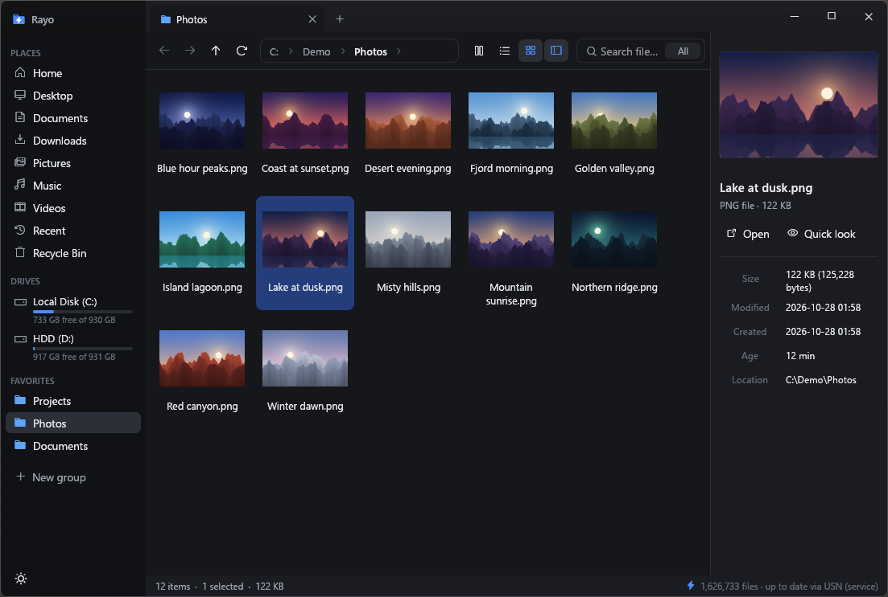
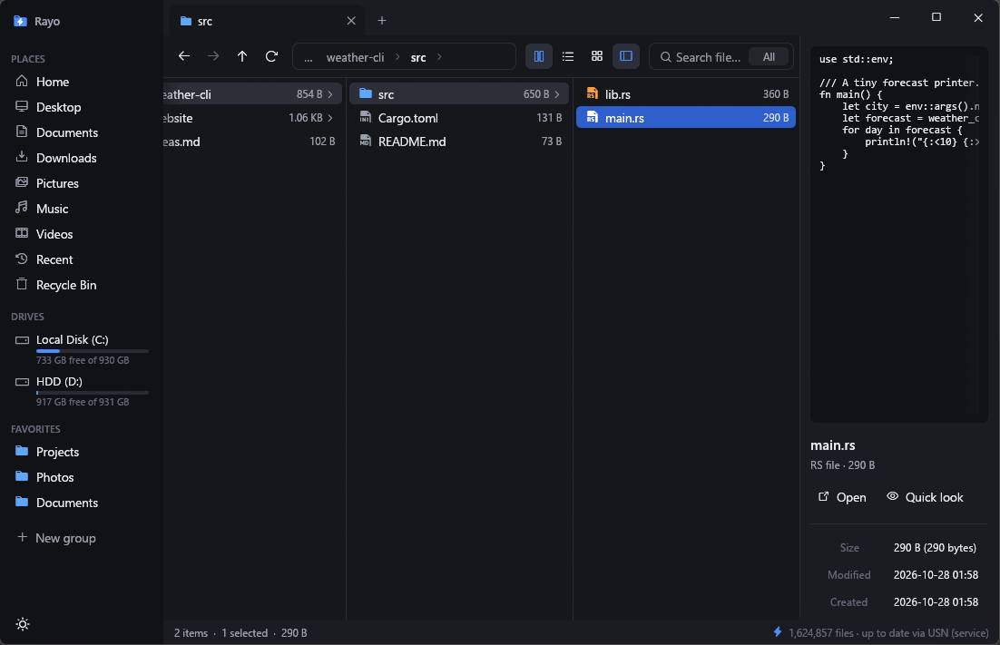
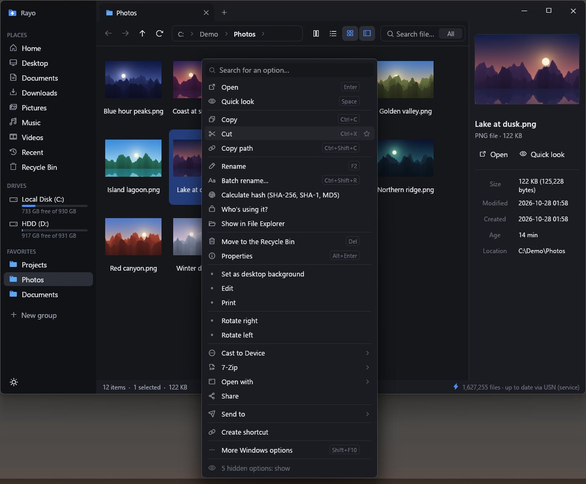
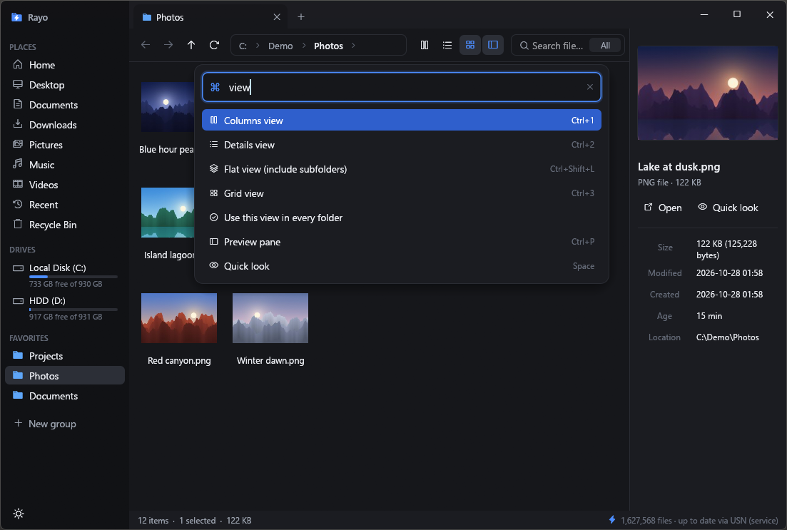
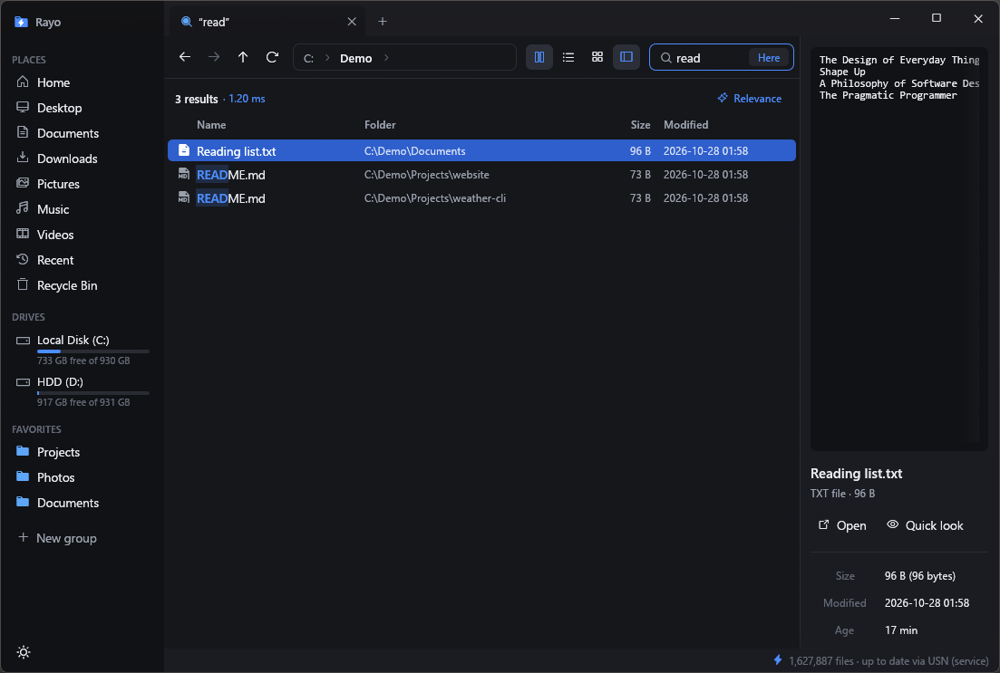
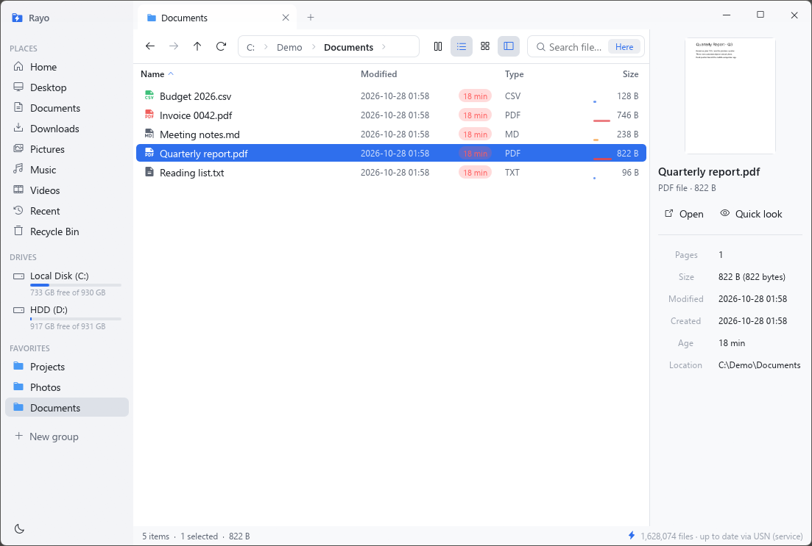

<div align="center">


# Rayo

**A fast, minimalist file explorer for Windows — with instant search built in.**

[](https://github.com/ElRobaMichis/rayo/actions/workflows/ci.yml)
[](https://github.com/ElRobaMichis/rayo/releases/latest)
[](LICENSE)


[Download](https://github.com/ElRobaMichis/rayo/releases/latest) ·
[Features](#features) ·
[Shortcuts](#keyboard-shortcuts) ·
[Build from source](#build-from-source) ·
[Contributing](CONTRIBUTING.md) ·
[Español](README.es.md)



</div>

Rayo is a native Windows file explorer written in Rust. It opens in a fraction of the time
File Explorer takes, searches your whole computer as you type, and brings ideas from Finder,
Directory Opus and OneCommander into a clean, modern interface — in a single 11 MB `.exe`
with no runtime to install.

## Highlights

- ⚡ **Instant search across every drive** — its own index answers typical queries in under a millisecond
  and stays up to date through the NTFS USN Journal.
- 🗂️ **Columns, details and grid views**, tabs, a split view with two panes, and a preview pane for images,
  PDFs, code, Markdown and Office documents.
- 🖱️ **One context menu for everything** — Rayo's actions plus Windows and app entries (7-Zip, VLC, “Send to”…),
  with a search box, pinning and the ability to hide what you never use.
- ⌨️ **Command palette** (`Ctrl+K`) with every action, plus a path bar that also runs commands.
- 🚀 **Copies up to 8× faster than File Explorer** — a drive-aware copy engine that copies many files at once
  on NVMe and SSD, stays sequential on hard drives, and starts before it finishes counting.
- 🧰 **Power tools included** — batch rename with live preview, duplicate finder, folder compare & sync,
  disk usage, hashes, “who is using this file?”, archives as folders, and undo for almost everything.
- 🌍 **English and Spanish**, and translatable by anyone with a spreadsheet — no recompiling.

## Screenshots

| | |
|:---:|:---:|
| <br>**Columns view** with live preview | <br>**Unified context menu** with search and pins |
| <br>**Command palette** (`Ctrl+K`) | <br>**Instant search** — results as you type |
| <br>**Light theme** and PDF preview | |

## Install

1. Download `rayo.exe` from the [latest release](https://github.com/ElRobaMichis/rayo/releases/latest).
2. Run it. The first time, Rayo offers to **install** itself (to `%LOCALAPPDATA%\Programs\Rayo`, with a
   Start menu entry and an uninstaller in *Installed apps*, no administrator rights needed) or to run
   **portable**.

> [!NOTE]
> The executable is not code-signed yet, so Windows SmartScreen may warn the first time.
> Click **More info → Run anyway**, or [build it yourself](#build-from-source).

Requirements: Windows 10 or 11 (x64). Optional: [7-Zip](https://www.7-zip.org/) to open 7z, RAR, ISO and more.

## Features

### Browsing
- **Columns view** (Finder-style), **details** with colored age badges and size bars, and a **grid** with thumbnails.
- **Tabs** and a **split view** (`Ctrl+\`) with drag and drop between panes — same drive moves, another drive copies.
- **Preview pane and Quick Look** (`Space`): images, PDFs (real pages), text and code, rendered Markdown, and
  Windows preview handlers (Word, Excel, PowerPoint, fonts, audio…).
- **Path bar with autocomplete**: drop files on a segment to move them there, drag a segment to another app,
  browse sibling folders with `▸`, or type `cmd`, `code .` or any program to run it in the current folder.
- **Type to filter** the current folder, **select by pattern** (`*.jpg; *.png`), flat view of all subfolders,
  and per-folder view and sort settings.
- **Thumbnails that don't stall**: Rayo reads the camera's embedded preview (~10 ms) before ever decoding a
  20 MB photo, so even galleries on spinning disks scroll smoothly.
- **OneDrive-aware**: cloud-only files are never downloaded just to show a thumbnail or preview.

### Search
- **Instant, system-wide search** while you type — case and accent insensitive (“cancion” finds “Canción”).
- **Query syntax**: `ext:pdf;docx`, `size:>1gb`, `dm:today` (`yesterday`, `week`, `7d`, `3h`…),
  `type:image` (`video`, `audio`, `doc`, `zip`, `code`, `exe`), `folder:` / `file:`, `!exclude`,
  `"exact phrase"`, wildcards like `*.mp4`, and paths like `documents\ invoice`.
- Scope a search to the current folder with one click, and reopen recent searches from history.

### Files and tools
- **A faster copy engine**, aware of the drives involved:
  - between NVMe/SSD drives it copies several files at once; with a hard drive or USB stick involved it goes
    one by one, in folder order, so the disk head doesn't jump around;
  - copying starts right away while files are still being counted — no “Calculating…” wait;
  - two copies that share a physical disk run one after the other, while copies on different disks run in parallel;
  - if it won't fit, it tells you while counting instead of halfway through;
  - over the network it asks SMB to compress the traffic when the server supports it;
  - plus speed, time left, pause, cancel and conflict handling (replace, skip, keep both).
- **Undo** (`Ctrl+Z`) for renames, batch renames, deletes (restores from the Recycle Bin), copies, moves,
  extractions, new ZIPs and new folders.
- **Batch rename** (`Ctrl+Shift+R`) with templates (`{name}`, `{n}`, `{date}`, `{exif}`, `{folder}`),
  find & replace with regular expressions, letter case, numbering and a live preview that catches
  collisions before anything is touched.
- **Archives as folders**: browse ZIP natively (and 7z, RAR, TAR, ISO… with 7-Zip), preview inside, drag out
  to extract, and compress to ZIP.
- **Duplicate finder**, **disk usage** (“what's taking up space here”), **folder compare & sync**
  (both ways, update or mirror), **hashes** (SHA-256, SHA-1, MD5) with verification, and **symbolic links**.
- **Who's using it?** — shows which program has a file locked and lets you close it, then retries.
- **Continue as administrator** only for the one operation Windows refused; Rayo itself keeps normal rights.
- **Built-in Recycle Bin** view, **recent files**, and safe drive **eject**.

### Windows integration
- **Optional default file explorer**: folders, drives and ZIPs opened from any app, `Win+E`, and your
  browser's “Show in folder” open in Rayo. Per-user, fully reversible, no administrator rights.
- **Windows 11 look**: tabs in the title bar, Snap Layouts, rounded corners, light and dark themes.
- **Single instance** that reopens in ~12 ms from the background (`Ctrl+Q` quits completely).

## Keyboard shortcuts

| Keys | Action |
|---|---|
| `Ctrl+K` | Command palette |
| `Ctrl+F` | Search |
| `Space` | Quick Look |
| `Ctrl+1` / `Ctrl+2` / `Ctrl+3` | Columns / details / grid view |
| `Ctrl+\` · `Tab` | Split view · switch pane |
| `Ctrl+T` / `Ctrl+W` / `Ctrl+Tab` | New tab / close tab / next tab |
| `Ctrl+L` | Type a path |
| `Ctrl+P` | Preview pane |
| `Ctrl+H` | Show hidden files |
| `F2` / `Ctrl+Shift+R` | Rename / batch rename |
| `Ctrl+Z` | Undo |
| `Ctrl+C` / `Ctrl+X` / `Ctrl+V` | Copy / cut / paste |
| `Ctrl+Shift+C` | Copy path |
| `Ctrl+Shift+N` | New folder |
| `Ctrl+Shift+S` / `Ctrl+I` | Select by pattern / invert selection |
| `Ctrl+Shift+L` | Flat view (all subfolders) |
| `Del` / `Shift+Del` | Recycle Bin / delete permanently |
| `Alt+←` / `Alt+→` / `Alt+↑` | Back / forward / up |
| `Alt+Enter` | Properties |
| `Shift+F10` | Full Windows context menu |
| `F5` | Refresh |
| `Ctrl+Q` | Quit Rayo |

## Performance

Measured on a Ryzen 7 9800X3D with 1.66 million files on `C:`:

| | |
|---|---|
| Cold start (window visible, folder listed) | ~305 ms (File Explorer: ~600 ms) |
| Reopen from the background | ~12 ms |
| Idle | 0 % CPU |
| Index ready (from cache) | ~285 ms after launch |
| Full index | 1.2 s reading the MFT; 1.5–7 s walking folders without admin |
| Typical search | 0.13–0.3 ms (average 0.69 ms) |
| CPU per frame | ~0.4 ms |

**Copying vs File Explorer** (File Explorer's own engine, `IFileOperation`, against Rayo's; median of
alternating runs with the disk idle in between; `cargo run --release --bin rayo-bench -- --copia <from> <to>`):

| Copy | File Explorer | Rayo | |
|---|---:|---:|---:|
| 20,000 small files, NVMe → NVMe | 39.5 s | 5.0 s | **7.9× faster** |
| 200 photos (850 MB), NVMe → NVMe | 0.62 s | 0.12 s | **5.1×** |
| 20,000 small files, NVMe → hard drive | 41.1 s | 12.0 s | **3.4×** |
| 20,000 small files, hard drive → NVMe | 29.5 s | 8.2 s | **3.6×** |
| 200 photos, NVMe → hard drive | 0.73 s | 0.33 s | **2.2×** |
| 2 GB file, NVMe → NVMe | 0.81 s | 0.76 s | 1.07× |

A single big file is limited by the drives, so both end up close; the gains come from everything around the
data — per-file overhead, waiting for the count, and using the drive the way it works best.

Against **Everything 1.4.1** (same 17 queries, top 1000 results, measured over its IPC), Rayo was faster on
every query: 0.69 ms vs 7.1 ms on average, 30–60× faster on text searches. Run the comparison yourself with
`cargo run --release --bin rayo-bench -- --cache`.

## How it works

- **Rust + [egui](https://github.com/emilk/egui) (OpenGL)**, redrawing only when something changes.
- **The index** keeps every file name of a drive in one contiguous, lowercased, accent-folded buffer. Searching
  is a parallel SIMD scan (`memchr`, Aho-Corasick for many extensions) that keeps only the best results per thread.
- **Indexing** reads the NTFS **MFT** directly when allowed, or walks folders in parallel otherwise, in a
  separate process so its memory is fully released afterwards.
- **Staying up to date**: an optional Windows service reads the **USN Journal** and streams changes to the app
  over a named pipe, so Rayo opens without reindexing and sees every change instantly. Without it, Rayo watches
  folders with `ReadDirectoryChangesW`.

Source layout: [`src/index`](src/index) (index and search), [`src/fsx`](src/fsx) (Windows file system and shell),
[`src/ui`](src/ui) (interface), [`idiomas`](idiomas) (translations).

## Build from source

You need [Rust](https://rustup.rs/) (stable, 1.85 or newer) on Windows.

```bash
git clone https://github.com/ElRobaMichis/rayo.git
cd rayo
cargo build --release
```

The executable ends up in `target/release/rayo.exe`. Run the tests with `cargo test --lib`.

To try changes without touching the Rayo you use every day, give the build its own settings and index:

```bash
set RAYO_DATA_DIR=%TEMP%\rayo-dev
target\release\rayo.exe
```

Copy engine diagnostics: `RAYO_COPY_THREADS=n` forces how many files are copied at once.

Useful switches: `--quit`, `--background`, `--revisar-idiomas` (check translations), `--install-service` /
`--uninstall-service` (as administrator). Diagnostics: `RAYO_DEBUG=1` writes timings to
`%LOCALAPPDATA%\Rayo\debug.log`; crashes are logged to `%LOCALAPPDATA%\Rayo\errores.log`.

`vendor/winit` is winit 0.30.13 with one added function (`prepare_keyboard_layout`) so the keyboard layout is
prepared on another thread while OpenGL starts.

## Translations

Every piece of interface text lives in a CSV file per language in [`idiomas/`](idiomas): a key, the text, the
Spanish original and a note for translators. Adding a language takes a spreadsheet, not a compiler:
open **Ctrl+K → Language… → Open the languages folder**, copy the template to `pt.csv` (or your language code),
fill in the `texto` column and pick it from the same dialog. Anything missing falls back to English.
See the [translation guide](idiomas/LÉEME.md).

## Contributing

Bug reports, ideas, translations and pull requests are welcome! Please read [CONTRIBUTING.md](CONTRIBUTING.md)
and our [Code of Conduct](CODE_OF_CONDUCT.md). To report a security issue, see [SECURITY.md](SECURITY.md).

## License

Rayo is released under the [MIT License](LICENSE).
`vendor/winit` keeps its own [Apache 2.0 license](vendor/winit/LICENSE).
